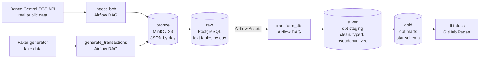
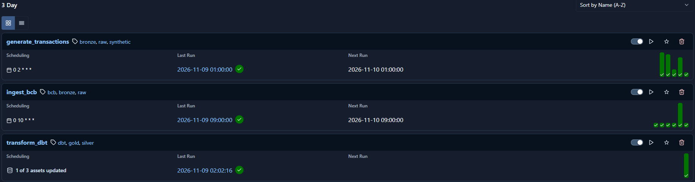
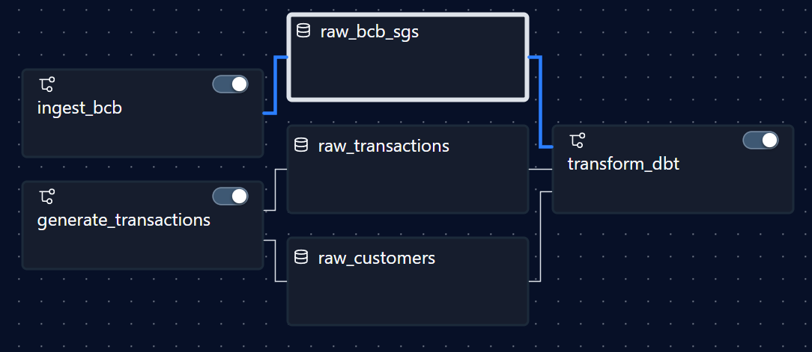
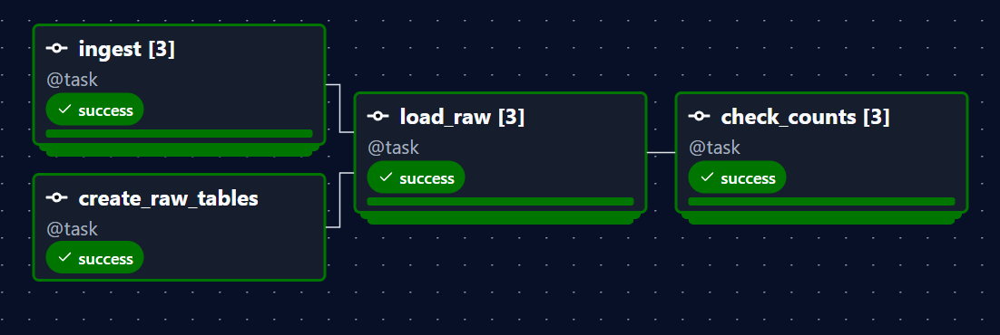
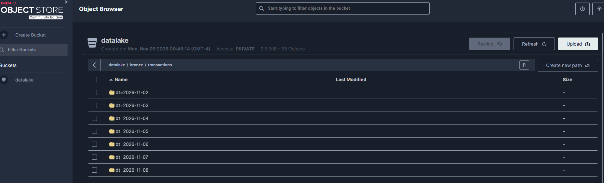
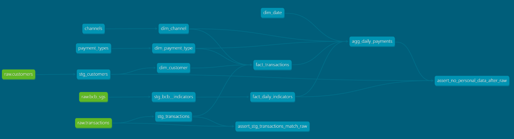
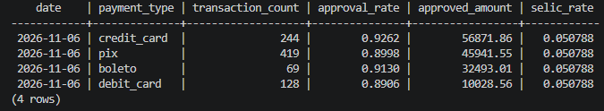
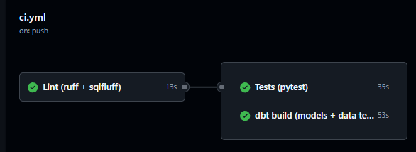
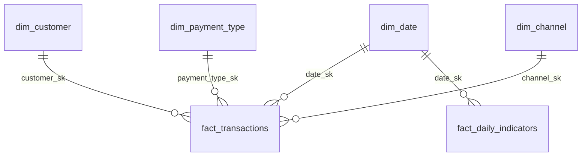

# payments-data-platform

[](https://github.com/paulocfg95/payments-data-platform/actions/workflows/ci.yml)
[](https://paulocfg95.github.io/payments-data-platform/)


**Data catalog and lineage (dbt docs):** https://paulocfg95.github.io/payments-data-platform/

> **Resumo (PT-BR):** Plataforma de dados de pagamentos para portfólio. Coleta indicadores reais do Banco Central (Selic, CDI e dólar PTAX) e gera transações sintéticas. Os dados passam por um data lake (bronze), um PostgreSQL (raw) e modelos dbt em star schema (silver e gold), com orquestração no Airflow, pseudonimização de dados pessoais (LGPD), testes automatizados com CI no GitHub Actions e catálogo de dados publicado.

## What this project does

A small but complete data platform for the payments domain. It collects real indicators from
the Banco Central do Brasil and generates fake payment transactions, stores the raw data in an
object storage (bronze), loads it into a PostgreSQL warehouse (raw), and models it with dbt as a
star schema (silver and gold). Everything runs locally with `docker compose up`.

**Status:** v1.0. Phases 1, 2 and 3 done (pipeline, star schema, CI and data catalog).
See [Roadmap](#roadmap).

## Architecture



| Layer | Where | What |
|---|---|---|
| bronze | MinIO (`bronze/<source>/dt=YYYY-MM-DD/<file>.json`) | Data as it came from the source |
| raw | PostgreSQL schema `raw` | Faithful copy of bronze, all columns `text` |
| silver | PostgreSQL schema `staging` (dbt `stg_*`) | Clean, typed, deduplicated, pseudonymized |
| gold | PostgreSQL schema `marts` (dbt) | Star schema ready for analysis |

Each ingestion DAG does three steps per file: **write to bronze → load into raw → check the
row count**. When the check passes, the DAG marks an Airflow Asset (`raw_bcb_sgs`,
`raw_customers`, `raw_transactions`) as updated. `transform_dbt` runs when all three assets
were updated, so dbt runs when new data arrives, not at a fixed time.

## See it running

**Airflow: the three DAGs**, with their schedules and recent runs. `transform_dbt` has no
clock schedule: it waits for the raw assets ("1 of 3 assets updated").



**Data-aware scheduling:** the two ingestion DAGs produce the raw assets, and the assets
trigger `transform_dbt`.



**`ingest_bcb` run:** one mapped task per BCB series (`[3]`), then load into raw and check the
row counts against bronze.



**Bronze layer in MinIO:** one partition per day (`dt=YYYY-MM-DD`). A re-run replaces the
files of that day.



**dbt lineage** (from the [data catalog](https://paulocfg95.github.io/payments-data-platform/)):
raw sources → silver (`stg_*`) → dimensions and facts → daily summary, plus the custom tests.



**Gold layer query:** daily summary by payment type for one day. Pix has the most transactions,
but credit card has the largest approved amount.



**CI on a pull request:** lint, tests and dbt build must pass before the merge.



## Tech stack

| Tool | Why |
|---|---|
| Python 3.12 | Extraction, generation and load code in small, testable modules |
| Apache Airflow 3.3 | Daily scheduling, retries, backfill, and Assets (data-aware scheduling) |
| MinIO (local S3) | Bronze layer with the same API as Amazon S3. The code uses boto3, so switching to S3 only changes env vars |
| PostgreSQL 16 | Data warehouse (raw, staging, marts) and Airflow metadata |
| dbt 1.11 + dbt_utils | SQL transformations, data tests, documentation and lineage |
| Faker | Fake customers and transactions (`pt_BR` locale) |
| pytest, responses, moto | Unit and integration tests without network or real cloud |
| ruff, sqlfluff | Python and SQL lint and format |
| GitHub Actions | CI on every pull request; publishes the dbt docs |
| GitHub Pages | Hosts the public data catalog |
| Docker Compose | One command to start everything |

## Data sources

**Banco Central do Brasil**, SGS time series API (real public data):

| Series | SGS code | Meaning |
|---|---|---|
| `selic` | 11 | Selic rate, % per day |
| `cdi` | 12 | CDI rate, % per day |
| `usd_brl_ptax` | 1 | USD/BRL exchange rate (sell), daily |

URL: `https://api.bcb.gov.br/dados/serie/bcdata.sgs.{code}/dados?formato=json&dataInicial=dd/MM/yyyy&dataFinal=dd/MM/yyyy`

**Synthetic payments** (fake data, generated with Faker):

| File | Content |
|---|---|
| `bronze/customers/dt=YYYY-MM-DD/customers.json` | Fixed registry of 500 customers (`cpf`, `name`, `email`, `state`, `city`, `created_at`, `segment`) |
| `bronze/transactions/dt=YYYY-MM-DD/transactions.json` | 800 to 1,500 transactions per day (`transaction_id`, `customer_cpf`, `transaction_at`, `payment_type`, `channel`, `amount`, `fee`, `status`) |

About 1% of the transactions are duplicated and about 0.5% have a null `customer_cpf` or
`amount`, on purpose. The silver layer cleans them and the data tests check the result.

## Dimensional model (gold)



`agg_daily_payments` is a summary table built from `fact_transactions` and
`fact_daily_indicators`, ready for dashboards.

| Model | Grain | Notes |
|---|---|---|
| `fact_transactions` | **one row per transaction** | `amount`, `fee`, `status`, `is_approved`. Incremental (unique key `transaction_id`) |
| `fact_daily_indicators` | one row per business day | `selic_rate`, `cdi_rate`, `usd_brl_ptax`. Incremental (unique key `date_sk`) |
| `dim_customer` | one row per customer | Pseudonymized: `customer_hash`, `state`, `city`, `segment`, `created_at` |
| `dim_date` | one row per day (2024 to 2027) | `date_sk` as `YYYYMMDD`, `is_weekend`, quarter, day of week |
| `dim_payment_type` | one row per payment type | From a dbt seed, with description |
| `dim_channel` | one row per channel | From a dbt seed, with description |
| `agg_daily_payments` | one row per day, payment type and channel | Counts, approval rate, amount, fee revenue, and the BCB indicators of the day |

Surrogate keys are made with `dbt_utils.generate_surrogate_key` (a hash of the natural key), so
they are the same in every run. This matters for the incremental fact tables.

### Data tests (dbt)

- `unique` and `not_null` on every key.
- `relationships` between each fact and its dimensions.
- `accepted_values` on `payment_type`, `channel`, `status` and `segment`.
- Custom generic test `positive_value` on `amount` and the BCB values; `accepted_range` on `fee`
  and `approval_rate`.
- `assert_stg_transactions_match_raw`: silver has exactly one row per distinct valid transaction in raw.
- `assert_no_personal_data_after_raw`: no column named `cpf`, `email` or `name` exists in silver or gold.

## How to run locally

Requirements: Docker Desktop, and Python 3.12+ for the tests.

```bash
# 1. Create your local config (change the passwords and the salt)
cp .env.example .env

# 2. Start everything
docker compose up -d --build
```

| Service | URL |
|---|---|
| Airflow UI | http://localhost:8081 (no login, local only) |
| MinIO console | http://localhost:9001 (user and password from `.env`) |
| Warehouse | `localhost:5433`, database `warehouse` |

Ports can be changed in `.env` (`AIRFLOW_PORT`, `WAREHOUSE_PORT`).

| DAG | Schedule | Does |
|---|---|---|
| `generate_transactions` | every day at 02:00 (São Paulo), previous day | Faker → bronze → raw |
| `ingest_bcb` | every day at 10:00 (São Paulo), previous day | BCB API → bronze → raw |
| `transform_dbt` | when all raw assets are updated | `dbt deps` and `dbt build` (models + tests) |

To load past days (backfill), run it for both ingestion DAGs. `transform_dbt` starts by itself
when they finish:

```bash
docker compose exec airflow-scheduler \
  airflow backfill create --dag-id generate_transactions --from-date 2026-11-02 --to-date 2026-11-07
docker compose exec airflow-scheduler \
  airflow backfill create --dag-id ingest_bcb --from-date 2026-11-02 --to-date 2026-11-07
```

This creates one run per day from 2026-11-02 to 2026-11-06. Airflow only creates a run when
the whole day is inside the range, so `--to-date` itself is not processed.
Add `--reprocess-behavior completed` to run again days that already ran.

Run dbt by hand (inside the Airflow container, where dbt is installed):

```bash
docker compose exec airflow-scheduler bash /opt/airflow/dbt/run_dbt.sh build
```

Query the gold layer:

```bash
docker compose exec warehouse psql -U warehouse -d warehouse \
  -c "SELECT date, payment_type, transaction_count, approval_rate, approved_amount, selic_rate
      FROM marts.agg_daily_payments WHERE channel = 'app' ORDER BY date, payment_type;"
```

### Tests and lint

```bash
python -m venv .venv
.venv/Scripts/activate        # Windows (Linux/macOS: source .venv/bin/activate)
pip install -r requirements-dev.txt
ruff check .
ruff format --check .
sqlfluff lint dbt/models dbt/tests
pytest
```

Tests marked `integration` use the warehouse from Docker Compose (schema `raw_test`, dropped
after each test). If the warehouse is not running, they are skipped. To run only unit tests:
`pytest -m "not integration"`.

## CI (GitHub Actions)

Every pull request and push to `develop` and `main` runs [`.github/workflows/ci.yml`](.github/workflows/ci.yml):

```
lint ──┬──> tests  pytest, with a temporary PostgreSQL, so integration tests run too
       └──> dbt    sample data into raw, then dbt build (models + data tests) and docs check
```

| Job | What it checks |
|---|---|
| `lint` | `ruff check`, `ruff format --check` and `sqlfluff lint` (SQL style of the dbt models) |
| `tests` | All pytest tests, including integration tests against PostgreSQL |
| `dbt` | `python -m src.load.sample_data` loads 3 days of sample data, then `dbt build` runs every model and data test, and `dbt docs generate` checks that the catalog builds |

The `dbt` job does not call the BCB API: it uses a small sample of real BCB values saved in the
repository ([`src/load/sample/bcb_sample.json`](src/load/sample/bcb_sample.json)), so CI never fails
because an external service is down. The transactions come from the same deterministic
generator as the real pipeline. Branch protection rules block the merge if any job fails.

## Data catalog (dbt docs)

The catalog is published at **https://paulocfg95.github.io/payments-data-platform/** by
[`.github/workflows/docs.yml`](.github/workflows/docs.yml) on every release (push to `main`).
It shows every table and column with its description, the tests, the SQL of each model, and
the **lineage graph** from the raw sources to the gold tables.

- It is built from the same 3-day sample as CI, so it never touches real or local data.
- The descriptions are also saved as PostgreSQL comments (`persist_docs`), so any SQL tool
  shows them, not only dbt docs.
- The pseudonymization salt is not in the compiled SQL, so the public site does not expose it.

To see the catalog of your local data:

```bash
docker compose exec airflow-scheduler bash /opt/airflow/dbt/run_dbt.sh docs generate --static
```

Then open `dbt/target/static_index.html` in the browser.

## Technical decisions

- **ELT.** Raw data is saved first, as it came from the source. Transformation happens later in dbt.
- **Idempotency, end to end.**
  - The day to process comes from the Airflow data interval, never from the clock.
  - Bronze: each run writes to a fixed key, so a re-run replaces the file.
  - Raw: `DELETE` of the partition and `INSERT` of the new rows in one database transaction.
  - Gold: incremental models with a `unique_key` and the `delete+insert` strategy. They process
    the rows loaded after the last run (`loaded_at`), so a re-run of a day replaces that day.
- **Row count checks.** Bronze vs raw after each load (Airflow task), and raw vs silver
  (dbt test). If the first check fails, the Asset is not updated and dbt does not run.
- **Pseudonymization (LGPD).** In silver, CPF and email become salted SHA-256 hashes, and the
  customer name is dropped (data minimization). The salt comes from an environment variable and
  reaches PostgreSQL as a session setting (`PGOPTIONS`), read with `current_setting()`. So the
  salt never appears in the dbt code, compiled SQL, logs or docs. A dbt test fails if a column
  with personal data exists after the raw layer.
- **Raw as text.** The raw layer does not convert types, so a bad value never breaks the load.
- **Deterministic generator.** The random seed is the processing date (`20261105`), so the
  same day always produces the same transactions. A golden test checks that the output is
  identical on every machine (laptop, Airflow container, CI).
- **Data-aware scheduling.** dbt runs on Airflow Assets, after the data arrives and passes the
  checks, instead of at a guessed time.
- **dbt in its own virtual environment** inside the Airflow image, so dbt and Airflow
  dependencies never conflict.
- **Empty days.** On weekends and holidays (for example 2026-11-02) the BCB API returns HTTP 404.
  The client treats this as "no data". `fact_daily_indicators` only has business days.
- **Failure handling.** HTTP timeouts, retries with exponential backoff on network errors,
  HTTP 429 and 5xx, response schema validation, and logs. Airflow also retries the tasks.
- **Testable code.** DAGs are thin. The logic lives in `src/` and is tested with pytest.
- **CI on every pull request.** Lint (Python and SQL), pytest and `dbt build` must pass before
  a merge. Python code, SQL and data are all tested automatically.
- **No secrets in the repo.** All credentials come from `.env` (ignored by git).
- **MinIO image.** The official MinIO images are no longer published, so the project uses
  the Chainguard build, pinned by sha256 digest.

## Synthetic data notice

Customer and transaction data are **fictional**, generated with Faker. No real personal data
is used. Even so, they are treated as personal data (pseudonymized) to show the LGPD practice.
BCB indicators are real public data.

## Roadmap

- **Phase 1 (done):** Docker Compose (Airflow, PostgreSQL, MinIO), BCB ingestion DAG, API client tests.
- **Phase 2 (done):** synthetic transaction generator, bronze → raw load, dbt staging and star
  schema, data tests, pseudonymization of CPF and email (LGPD).
- **Phase 3 (done):** GitHub Actions CI (ruff, sqlfluff, pytest, `dbt build`), `dbt docs`
  catalog and lineage on GitHub Pages, diagrams and screenshots.

Possible next steps:

- **Bronze on Amazon S3.** The code already uses boto3 (S3 API); switching from MinIO is a
  configuration change, plus an IAM policy that only allows access to the bucket.
- **SCD type 2 for customers** (`valid_from`, `valid_to`, `is_current`) to keep the history of
  changes such as a new city or segment.
- **Holidays in `dim_date`**, from a public holiday calendar.
- **Data freshness checks** with `dbt source freshness`.
- **Bigger volumes** with Spark or Databricks, keeping the same bronze, silver and gold layers.

## Repository layout

```
airflow/dags/        Airflow DAGs (ingest_bcb, generate_transactions, transform_dbt)
src/extract/         BCB API client and ingestion job
src/generate/        Synthetic customer and transaction generator
src/load/            Bronze writer (S3 / MinIO) and raw loader (PostgreSQL)
dbt/models/staging/  Silver layer (stg_*)
dbt/models/marts/    Gold layer (star schema)
dbt/seeds/           Reference data (payment types, channels)
dbt/tests/           Custom dbt tests
tests/               pytest
.github/workflows/   CI (lint, pytest, dbt build) and dbt docs to GitHub Pages
.github/actions/     Shared CI steps (dbt + sample data)
docker/airflow/      Airflow image (with dbt in its own virtual environment)
docs/images/         Screenshots used in this README
docker-compose.yml
```
